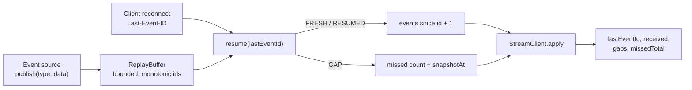

# resumable

Server-sent events with a real `Last-Event-ID` contract and an explicit gap signal, so a reconnect never silently skips events.

[](https://github.com/SlateGitOrg/resumable/actions/workflows/ci.yml)
[Live demo](https://slategitorg.github.io/resumable/)

## Why

Live event feeds drop connections constantly on mobile networks. Most implementations reconnect and resume from "now", so a viewer who lost signal for eight seconds never sees the elimination, the goal or the price change that happened in that window, and has no way to know they missed it. Honouring `Last-Event-ID` is not enough either: the replay buffer is bounded, and an implementation that quietly restarts from the oldest event it still has looks healthy while losing data. `resumable` makes the failure explicit.

## Features

- Monotonic per-channel event IDs and a bounded replay buffer (`ReplayBuffer`).
- `Last-Event-ID` resume that starts at `lastEventId + 1`, with three distinct outcomes: `FRESH`, `RESUMED` and `GAP`.
- Explicit gap detection: when the resume point has been evicted, the server reports how many events were missed and the snapshot id to rebase on.
- A client state tracker (`StreamClient`) that records gaps and exposes a missed-events total a UI can show.
- SSE wire encoding (`id:`, `event:`, `data:` frames).
- A browser demo that runs the scenario with adjustable inputs.

## Architecture



The server side is one class, `ReplayBuffer`, which assigns ids and evicts the oldest events past `capacity`. `resume()` is a pure function of the buffer and the client's last seen id. `StreamClient` models the browser side: it applies each outcome, rebases onto the snapshot after a gap, and keeps an explicit record of the hole instead of pretending the events arrived.

## Quick start

Requires Node 22.6+ (24 recommended). There is no build step and no `node_modules`; TypeScript runs through Node's type stripping. On Node 22.6 to 22.17 set `NODE_OPTIONS=--experimental-strip-types`; Node 22.18+ and 24 need nothing extra.

```bash
git clone https://github.com/SlateGitOrg/resumable.git
cd resumable
npm test        # full suite (20 tests)
npm run demo    # 1,000 simulated reconnects, three server behaviours
```

## Usage

```ts
import { ReplayBuffer, StreamClient } from './src/stream.ts';

const buffer = new ReplayBuffer(512);
const client = new StreamClient();
client.apply(buffer.resume(null));              // first connection: FRESH

buffer.publish('tick', { n: 1 });
client.apply(buffer.resume(client.lastEventId)); // reconnect: RESUMED
```

Output of `npm run demo` (trimmed):

```text
  24,540 events published while the client was dropping in and out.

  server behaviour                 delivered   lost    gaps reported
  ignores Last-Event-ID            0           24540   0
  honours it, rebases silently     7390        17150   0
  this implementation              24540       0       0

  GAP  requested id 6, oldest retained 96, missed 90 events
  -> refetch snapshot at id 105, and tell the viewer
```

## How it works

- **Resume coordinate.** The client sends the last id it saw, so delivery starts at `lastEventId + 1`. An off-by-one here duplicates or drops one event per reconnect.
- **Already current.** A client whose id is at or past the newest id gets an empty `RESUMED` result, not a gap.
- **Gap rule.** If `lastEventId + 1` is older than the oldest retained id, the result is `GAP { missed, oldestAvailable, requested, snapshotAt }`. The client rebases to `snapshotAt` and records the loss.
- **Eviction.** The buffer is a fixed-capacity FIFO; ids keep increasing across eviction, so ids never repeat.
- **Evidence.** The demo compares three behaviours over the same seeded workload: ignoring the header, honouring it but rebasing silently, and this implementation. Only the last delivers everything and reports gaps when loss is unavoidable.

See [docs/ARCHITECTURE.md](docs/ARCHITECTURE.md) for design decisions and failure modes.

## Testing

```bash
npm test
```

`tests/ordering.test.ts` checks, across 1,000 scripted disconnects, zero lost events, zero duplicates, strict ordering and exact set equality with what was published. It also exercises the gap path (reported, counted, recorded by the client, clean resume afterwards), the off-by-one edge cases around the oldest retained id, buffer bounds, monotonic ids and SSE framing. `site/core.test.mjs` covers the browser demo logic.

## Project layout

```text
src/stream.ts            ReplayBuffer, StreamClient, SSE encoding
src/demo.ts              reconnect comparison demo
tests/ordering.test.ts   resume, gap and buffer tests
site/                    browser demo (deployed to GitHub Pages)
docs/ARCHITECTURE.md     design decisions and failure modes
```

## Limitations

- The replay buffer is in memory and per process; there is no Redis backing, HTTP server or browser hook in this repository.
- It is not a message broker: bounded replay with honest failure, nothing more.
- The demo workload is synthetic.

## License

MIT — see [LICENSE](LICENSE).
