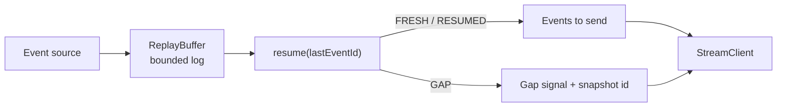

# Architecture

## Context

Live feeds (tournament events, scores, prices) are delivered over server-sent events. Mobile clients drop and reconnect constantly. The usual fallback is to resume from the live edge, which silently loses whatever happened during the outage. `resumable` is the replay and resume layer that prevents silent loss.

## Container view

## Key decisions

- **Three outcomes, not two.** `FRESH` (no resume point), `RESUMED` (all events since the resume point) and `GAP` (resume point evicted). A resume that cannot be honoured is reported, never disguised as a successful one.
- **Bounded buffer.** Memory is capped at `capacity` events per channel. The cost is that long outages cannot be replayed; the gap signal and snapshot refetch cover that case.
- **Resume at `lastEventId + 1`.** The id is what the client last saw, so it is excluded from replay.
- **Monotonic ids across eviction.** Ids are never reused, so a stale id is always distinguishable from a valid one.
- **Client records the hole.** After a gap `StreamClient` rebases to the snapshot id and stores `{ missed, at }`, so the UI can show how much was missed.

## Failure modes

- Resume point evicted: `GAP` with `missed`, `oldestAvailable`, `requested` and `snapshotAt`.
- Buffer empty with a stale id: reported as a gap.
- Client already current: empty `RESUMED`, not a gap.
- Process restart: the in-memory buffer is lost, so every client resumes into a gap.

## Out of scope

Persistence, fan-out across processes, authentication, and the HTTP transport itself.
